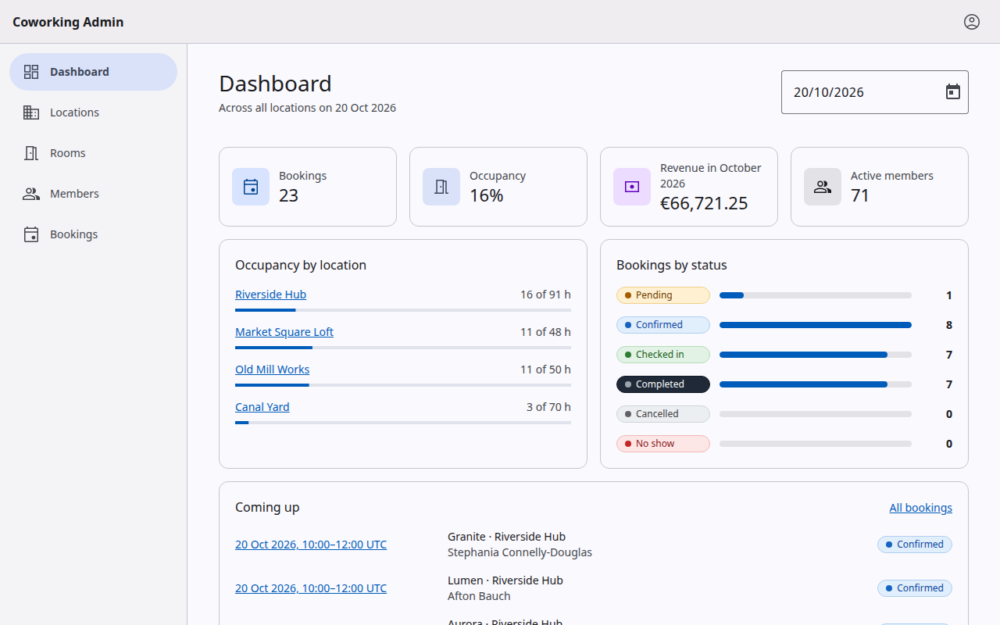
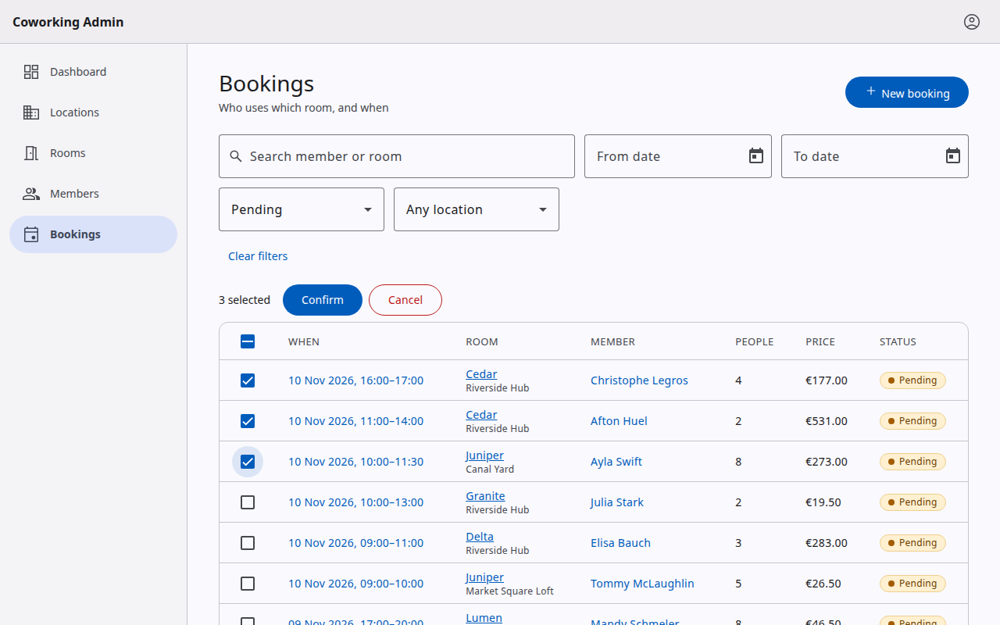
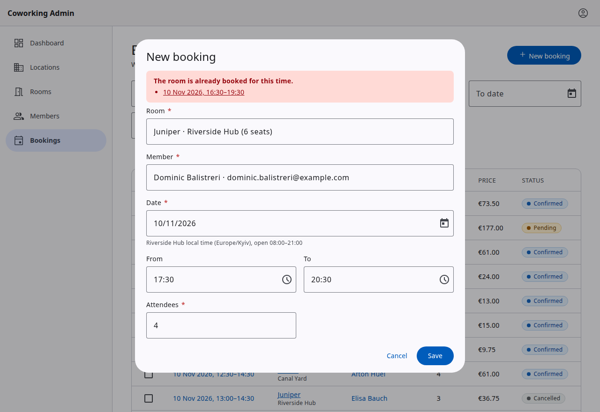

# Coworking Admin

Admin console for a network of coworking spaces: locations, rooms, members and bookings, with a
dashboard of the day's occupancy. An Angular 22 single-page app (standalone components, zoneless,
signals) over a REST API, shipped with an in-repo mock backend, so it runs without any real server.

It is a reference project for the questions a larger admin app has to answer: how server state is
cached and invalidated, where list state lives, how forms agree with the API, and how layer rules
are kept from eroding.



- **Bookings that follow the rules:** at most 8 hours, inside the location's opening hours on its
  own clock (including the night the clocks change), within room capacity. An overlap is refused
  with the conflicting bookings listed, as links, in the form.
- **Status workflow:** `pending → confirmed → checked_in → completed`, plus cancel and no-show,
  one by one or in bulk, with a per-booking report of what failed and why.
- **Lists you can share:** page, size, search and filters live in the URL, so a filtered list
  survives a reload, a bookmark and the Back button.
- **Errors where they belong:** validation errors under their fields, conflicts in the form,
  everything else in a snackbar; an expired session sends you back to sign in and returns you.
- **Accessible and themed:** axe checks every screen and open dialog, and the busiest ones in both
  colour schemes; light and dark follow the system setting.

|                                                  |                                                      |
| ------------------------------------------------ | ---------------------------------------------------- |
|                    |        |
| Filtered list with rows ticked for a bulk action | Overlapping booking refused, dialog stays open (409) |

## Quick start

### Full demo in Docker

```bash
docker compose up --build
```

Open http://localhost:8080 and sign in with **admin@coworking.test** / **demo1234**. The web image
serves the production build with nginx and proxies `/api` to the mock API container.
`docker compose pull && docker compose up` runs the images published to GHCR instead of building
them.

### Local development

Requires Node.js 22.12 or newer (`.nvmrc` pins 24, which CI uses).

```bash
npm ci
npm run dev   # mock API on :4010 and the app on http://localhost:4200, /api proxied to the mock
```

`npm run mock` and `npm start` run the two halves separately. The mock keeps its data in memory
and starts from the same seed every time; `MOCK_LATENCY_MS`, `MOCK_SEED` and `PORT` tune it.

## Stack

| Area         | Choice                                                                         |
| ------------ | ------------------------------------------------------------------------------ |
| Framework    | Angular 22: standalone components, zoneless change detection, signals          |
| UI           | Angular Material 22 (Material 3 tokens, light and dark), SCSS                  |
| State        | NgRx Signals (`signalStore`) for session and list state                        |
| Server state | `httpResource` behind small query and mutation factories, own tag-based cache  |
| Forms        | Signal Forms with Zod 4 schemas through Standard Schema                        |
| Mock API     | Node `http`, `@faker-js/faker` seed data, the same core served as MSW handlers |
| Tests        | Vitest 5, Testing Library, MSW, Playwright (Chromium and Firefox), axe-core    |
| Tooling      | TypeScript 6, ESLint 10 with `eslint-plugin-boundaries`, Prettier, esbuild     |
| CI/CD        | GitHub Actions, Docker images on GHCR, nginx (unprivileged)                    |

Why these, where the choice is not obvious:

- **`httpResource` plus a small cache instead of a query library.** `httpResource` already gives
  signals, cancellation and typed reloads. What it lacks is invalidation across screens: a room
  edit must refresh the bookings, locations and dashboard that embed it. About 700 lines in
  `core/api` and `core/http` add tags, a 60 s GET cache and request sharing, and the rules stay
  readable in one place.
- **Signal Forms with Zod.** One schema describes a request body; the form validates with it and
  the mock server parses with it, so the client and the API cannot disagree about a rule.
- **URL as the only list state.** `withListParams` derives `page`, `limit`, `q` and typed filters
  from the query string and writes changes back with `replaceUrl`. There is no second copy to
  synchronise, and one change of state is exactly one request.
- **Material tokens, `light-dark()`.** Material 3 colours are CSS variables that resolve through
  `color-scheme`, so the system preference selects the theme with no class and no second
  stylesheet; component styles use `--mat-sys-*` tokens, never raw colours.
- **The mock lives in the repo.** It runs the real contract in Node, serves the e2e suite and the
  Docker demo, and its core is also mounted as MSW handlers for component tests, so those tests go
  through the full HTTP pipeline instead of stubbing services.

## Architecture

```
src/app/
  app.ts, app.config.ts, app.routes.ts   assemble the application
  core/      one instance per app: data layer (api/, http/), session (auth/), shell (layout/)
  shared/    app-agnostic: ui/, forms/, util/, and api/contract (the Zod contract)
  features/  one folder per slice: auth, dashboard, locations, rooms, members, bookings
    <name>/  routes, data/ (queries, mutations), store/ (list state), pages/, dialogs/
src/testing/ test setup and helpers, imported by specs only
server/      mock API; imports only shared/api/contract
e2e/         Playwright suite with page objects; drives the built app from outside
```

Imports go downward only: features to `core` and `shared`, `core` to `shared`, `server` to the
contract. A feature never imports another feature, and the contract imports nothing but Zod,
because the mock runs it in Node. ESLint (`eslint-plugin-boundaries`, `default: 'disallow'`,
`no-unknown-files`) enforces this on every file, so a new top-level folder has to be added to the
layer map on purpose. Folders are crossed through the `@core/*`, `@shared/*` and `@features/*`
aliases.

**Data flow.** A page calls a feature's factory (`injectRoomsQuery(params)`), which calls
`createQuery` or `createMutation` in `core/api`. A query wraps `httpResource`; the interceptors add
the base URL and token, serve and fill the cache, and turn failures into session or snackbar
events; the request ends at the mock. Responses are checked against the Zod contract, and a
mismatch is logged but never blocks the data.

**Tags and invalidation.** A query names what it shows from its inputs, never from the response
(`idTag('Room', id)`, `listTag('Room')`). A mutation names what it made stale (`savedTags`,
`removedTags`), and one `EMBEDDED_IN` table adds the entities that embed the changed one. Cached
entries are dropped when a tag is invalidated or the TTL ends; sign-out clears the whole cache.

**Errors.** 401 ends the session once and returns to sign-in with the page kept; 404 renders a
not-found state; 409 and 422 stay in the form (the request is marked `silent`), mapped onto fields
or a banner; everything else is a snackbar.

## Testing

| Suite              | Runs on                | What it covers                                                    |
| ------------------ | ---------------------- | ----------------------------------------------------------------- |
| Unit and component | Vitest, jsdom          | 1457 tests, Testing Library by role, the real data layer over MSW |
| Mock server        | Vitest, Node           | 14 tests: contract, booking rules, status transitions             |
| End to end         | Playwright             | 60 scenarios in Chromium and Firefox (120 runs), page objects     |
| Accessibility      | axe-core in Playwright | WCAG 2.0/2.1 A and AA plus best practices, light and dark         |

`npm test` is one-shot and fails below 90 % lines or branches for `src/app` (currently 100 % lines,
98.8 % branches). Specs sit next to the code; the specs that run a section through the real routes,
guard and shell are `src/app/*.integration.spec.ts`.

```bash
npm test                              # unit, component and server tests with coverage
npx playwright install chromium firefox   # once
npm run e2e                           # builds the app, starts the mock, runs both browsers
npx playwright test --grep @a11y      # accessibility checks only
E2E_BASE_URL=http://localhost:8080 npm run e2e   # the same suite against docker compose
```

The mock has one database, so e2e tests run one at a time and each starts with a reset.

## Scripts

| Script                                    | Description                                            |
| ----------------------------------------- | ------------------------------------------------------ |
| `npm run dev`                             | Mock API and dev server together, `/api` proxied       |
| `npm start` / `npm run mock`              | Dev server on :4200 / mock API on :4010                |
| `npm run build`                           | Production build into `dist/`                          |
| `npm run build:mock`                      | Bundle the mock API into one file (used by its image)  |
| `npm run typecheck`                       | `ngc` over templates, `tsc` over specs, server and e2e |
| `npm run lint`                            | ESLint, including the layer boundaries                 |
| `npm run format` / `npm run format:check` | Prettier                                               |
| `npm test` / `npm run test:watch`         | App and server tests, coverage thresholds / watch mode |
| `npm run e2e`                             | Playwright suite                                       |

## CI/CD

[GitHub Actions](.github/workflows/ci.yml) runs on every push to `main`, `v*` tags and pull
requests:

1. **checks:** typecheck, lint, format check, tests with coverage thresholds, production build;
2. **e2e:** the Playwright suite in Chromium and Firefox; a failed run uploads its report;
3. **images** (pushes only): builds and publishes to GHCR
   - `ghcr.io/tumarok/coworking-admin-angular`: the app on `nginx-unprivileged` (port 8080), `/api`
     proxied to `$API_UPSTREAM`;
   - `ghcr.io/tumarok/coworking-admin-angular-api`: the mock API bundled into one file.

   Tags: `latest` for `main`, `sha-<commit>`, and `1.2.3` / `1.2` for a `v1.2.3` tag.

The initial bundle of the production build is about 339 kB raw, 94 kB transferred; every route,
the form dialogs and the date and time pickers are lazy chunks.

## Contributing

```
docker/             Dockerfiles and the nginx config
compose.yaml        web and API containers
docs/               screenshots used above
.github/workflows/  CI
```

Before a commit, `npm run typecheck && npm run lint && npm run format:check && npm test &&
npm run build` must pass, plus `npm run e2e` when routes, forms or API behaviour change. Commits
follow Conventional Commits.

The working rules for contributors are in `.claude/CLAUDE.md`.

## License

[MIT](LICENSE)
